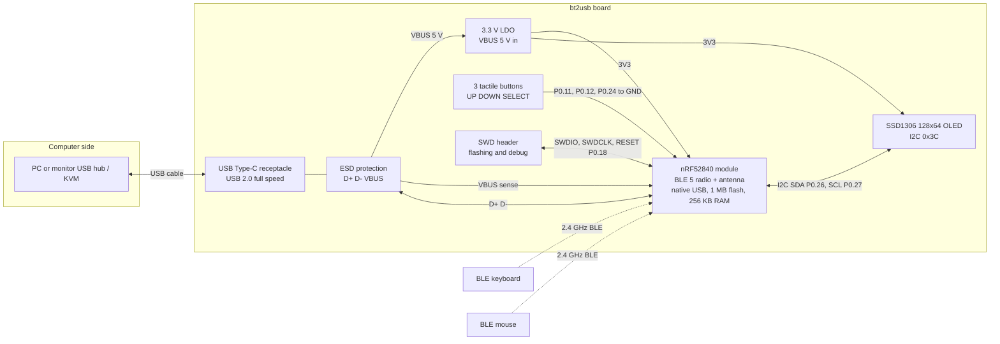

# Prototype Hardware Brief

This brief tells a hardware partner what to build so that the bt2usb firmware
runs on it unchanged. It is written to be sent as is: everything a schematic,
layout, bill of materials and enclosure need is here, and every point the
repository does not decide is listed under [Open Questions](#open-questions).
The firmware owner flashes the firmware; the partner delivers boards that are
blank, or carry whatever the module maker loaded, with the debug port
reachable.

The facts come from the source, the linker scripts and the
[hardware reference](hardware.md), which stays the one home for how the
firmware uses the hardware. Where this brief recommends a part or a design
choice that the repository does not fix, it says so. No board has passed the
[first-flash checklist](first-flash.md) yet, so the prototype run is also the
first hardware acceptance target ([TODO.md](../TODO.md#board-bring-up-and-hardware-acceptance)).

## What The Product Is

bt2usb is a small USB-powered box that sits on a monitor's USB hub or a KVM
switch. It connects to up to two Bluetooth LE keyboards and mice and presents
them to the computer as an ordinary wired USB keyboard, mouse and
media-control device. The computer needs no Bluetooth and no software, the
devices work in the BIOS, and they follow the hub or KVM to whichever computer
it selects. A 128×64 OLED and three buttons (UP, DOWN, SELECT) are used to
scan, pair, forget and inspect devices
([features](features.md)).

| Responsibility | Partner (Anvol) | Firmware owner |
| --- | --- | --- |
| Schematic, PCB layout, fabrication, assembly | Yes | Reviews against this brief |
| Bill of materials and part sourcing | Yes | Reviews against this brief |
| Enclosure design and parts | Yes | Reviews fit and button feel |
| Electrical check of each unit (rails, SWD connect) | Yes, see [Acceptance On Delivery](#acceptance-on-delivery) | — |
| SoftDevice S140 and firmware programming | No; ship blank | Yes, over SWD |
| Functional test (self-test, BLE, USB) | No | Yes, with `mask selftest` and [first flash](first-flash.md) |

## Block Diagram



The board is bus-powered only: no battery, no charger, no sleep mode that
drops USB ([ADR 0012](adr/0012-bus-powered-no-system-off.md)).

## Core Requirements

| Area | Requirement | Why |
| --- | --- | --- |
| MCU | Nordic nRF52840, package QIAA (aQFN73) or a module built on it, 1 MB flash and 256 KB RAM | The build, linker script and `probe-rs` target are `nRF52840_xxAA` ([memory layout](hardware.md#memory-layout)) |
| Chip revision | Revision 3, build code F or later, preferred | [ADR 0021](adr/0021-provisioning-debug-access-and-readout-protection.md) recommends it for production debug locking; still an open decision |
| Radio stack | Nordic SoftDevice S140 v7.3.0, flashed by the firmware owner | The memory map reserves its flash and RAM ([ADR 0002](adr/0002-nrf52840-softdevice-embassy.md)) |
| Antenna | Integrated in a pre-certified module (chip or PCB antenna) | Keeps the module's FCC/CE/IC grants and avoids an RF matching design |
| High-frequency crystal | 32 MHz, ±40 ppm or better (inside the module) | USB and the radio both run from it; the firmware requests it at boot |
| Low-frequency crystal | Not required | The firmware uses the internal RC oscillator; a module that has the 32.768 kHz crystal is fine |
| Supply | USB VBUS 5 V only; external 3.3 V LDO feeding VDD, nRF52840 in normal-voltage mode (recommended), or 5 V into VDDH | Both work with the firmware; see [Supply Mode](#supply-mode) |
| USB | Native nRF52840 USB 2.0 full speed, D+ and D− straight to the connector, VBUS to the nRF52840 VBUS pin | The firmware learns about the cable only from VBUS events |
| Display | SSD1306 128×64 monochrome OLED, I2C address 0x3C, powered from 3.3 V | Fixed in the firmware ([OLED display](hardware.md#oled-display)) |
| Buttons | Three normally open momentary switches, each from its GPIO to GND | Internal pull-ups and 50 ms software debounce; no external parts ([buttons](hardware.md#buttons)) |
| Debug access | SWD (SWDIO, SWDCLK, RESET, VDD, GND) on a header or test-pad footprint reachable without desoldering | All flashing and recovery is over SWD; there is no bootloader |
| Enclosure | Small plastic case with an OLED window, three button actuators, a USB-C opening, and no metal near the antenna | See [Enclosure](#enclosure) |

## MCU And Memory

Every nRF52840 has 1 MB of flash and 256 KB of RAM; the variant choices that
matter are the package, the revision, and whether a module is used. The
firmware is linked for this layout ([memory_sd.x](../memory_sd.x)):

| Region | Address range, end exclusive | Owner |
| --- | --- | --- |
| SoftDevice S140 v7.3.0 | `0x00000000–0x00027000` | Nordic radio stack, flashed once per board |
| Application | `0x00027000–0x000F0000` | bt2usb firmware |
| Pairing storage | `0x000F0000–0x000F4000` | Bonds of up to four devices |
| Unused | `0x000F4000–0x00100000` | Free |
| SoftDevice RAM | `0x20000000–0x20006000` | Nordic radio stack |
| Application RAM | `0x20006000–0x20040000` | bt2usb firmware |

There is no bootloader. A module or board that ships with one (for example a
UF2 or Nordic USB DFU bootloader) is fine, because the firmware owner erases
the whole chip over SWD before flashing; it just must not be relied on.

Recommended approach: a **pre-certified nRF52840 module** rather than the bare
chip. Candidates the partner may choose from, subject to the pin check below:

| Module | Antenna | Notes |
| --- | --- | --- |
| Raytac MDBT50Q-1MV2 | Chip antenna | Preferred example; breaks out USB D+, D−, VBUS and most GPIOs |
| Raytac MDBT50Q-P1MV2 | PCB antenna | Same module family |
| Ebyte E73-2G4M08S1C | PCB antenna | Common in Shenzhen; check that USB and VBUS are broken out |
| Minew MS88SF2 | Chip antenna | Check the GPIO breakout |

Whichever module is chosen, its datasheet must show: the nRF52840 USB D+, D−
and VBUS pins; VDD and VDDH pins (or a documented supply mode); SWDIO,
SWDCLK and RESET (P0.18); and the GPIOs in the [pin map](#pin-map). If the
module does not break out one of the signal GPIOs, the partner proposes
another free GPIO and the firmware owner changes the pin assignment in
`src/main.rs` and `src/selftest.rs`, which is a small change.

A chip-down design (bare nRF52840-QIAA) is possible but then needs Nordic's
reference circuit: the 32 MHz crystal and its load capacitors, DEC1 to DEC6
decoupling, the RF matching network and antenna, an RF layout review, and its
own radio certification. It is not recommended for this prototype.

## Pin Map

| Signal | nRF52840 pin | Direction | Connect to | Notes |
| --- | --- | --- | --- | --- |
| BTN_UP | P0.11 | Input, internal pull-up | Switch to GND | Active low |
| BTN_DOWN | P0.12 | Input, internal pull-up | Switch to GND | Active low |
| BTN_SELECT | P0.24 | Input, internal pull-up | Switch to GND | Active low |
| OLED_SDA | P0.26 | I2C data (TWIM0) | OLED SDA | 100 kHz; internal pull-up on, 4.7 kΩ pads recommended |
| OLED_SCL | P0.27 | I2C clock (TWIM0) | OLED SCL | As above |
| USB_DP | D+ | USB | Connector D+ (A6 and B6 on Type-C) | 90 Ω differential, short, no series resistors (internal) |
| USB_DM | D− | USB | Connector D− (A7 and B7 on Type-C) | As above |
| VBUS | VBUS | Power sense and USB regulator input | Connector VBUS after ESD | Required for USB to start |
| SWDIO | SWDIO | Debug | SWD header | — |
| SWDCLK | SWDCLK | Debug | SWD header | — |
| nRESET | P0.18 | Pin reset | SWD header, optional reset switch to GND | The firmware keeps P0.18 as the reset pin |

Pins to leave free or unconnected to anything that drives them:

| Pin | Reason |
| --- | --- |
| P0.00, P0.01 | 32.768 kHz crystal pins (optional crystal) |
| P0.09, P0.10 | NFC antenna pins; the firmware keeps them in NFC mode, not as GPIO |
| P0.18 | Pin reset, see above |
| P0.06, P0.08 | Not used on the board; the simulation uses them for a UART log, and a test pad for each is welcome for debugging |

No LED is driven by the firmware. A power LED on 3.3 V is optional; if added,
keep its current at 1 mA or less.

## Schematic Outline

This is the netlist the schematic must implement. Part values are
recommendations; the partner may substitute equivalents.

### Power And USB

```text
 USB-C receptacle (16-pin, USB 2.0)
 ┌──────────────┐
 │ VBUS A4/A9/  ├──┬──[F1 PTC 500 mA, optional]──┬───────────────► VBUS_5V
 │      B4/B9   │  │                             │
 │ CC1  A5      ├──┼──[R1 5.1 kΩ]── GND          ├──[C1 4.7 µF]── GND   (≤ 10 µF total on VBUS)
 │ CC2  B5      ├──┼──[R2 5.1 kΩ]── GND          │
 │ D+   A6, B6  ├──┼───────┬──────────────────────────────────────► USB_DP (to nRF D+)
 │ D−   A7, B7  ├──┼───────┼──┬───────────────────────────────────► USB_DM (to nRF D−)
 │ GND  A1/A12/ ├──┴─ GND  │  │
 │      B1/B12  │          │  │
 │ SHIELD       ├──[R 1 MΩ ∥ C 4.7 nF]── GND   (or direct to GND, partner's choice)
 └──────────────┘          │  │
                        ┌──┴──┴──┐
                        │  U2    │  USBLC6-2SC6 ESD array: I/O1 = D+, I/O2 = D−,
                        │  ESD   │  VBUS pin = VBUS_5V, GND = GND
                        └────────┘

 VBUS_5V ──┬─────────────────────────────────────► nRF52840 VBUS pin
           │
           └──► U3 AP2112K-3.3 (or equivalent, ≥ 300 mA, ≤ 6 V in)
                IN ── C2 1 µF ── GND
                EN ── tied to IN
                OUT ──┬── C3 1 µF ── GND
                      ├── C4 10 µF ── GND
                      └──────────────► 3V3 rail

 3V3 ──► nRF52840 VDD and VDDH (tied together: normal-voltage mode),
         module decoupling per its datasheet,
         OLED VCC, I2C pull-ups, SWD VTref
```

### MCU, Buttons, Display And Debug

```text
                       nRF52840 module (U1)
                  ┌───────────────────────────┐
 3V3 ────────────►│ VDD, VDDH                 │
 VBUS_5V ────────►│ VBUS                      │
 USB_DP ◄────────►│ D+                        │
 USB_DM ◄────────►│ D−                        │
                  │                      P0.11├──── SW1 (UP) ────── GND
                  │                      P0.12├──── SW2 (DOWN) ──── GND
                  │                      P0.24├──── SW3 (SELECT) ── GND
                  │                      P0.26├──┬─────────────────► OLED SDA
                  │                      P0.27├──┼──┬──────────────► OLED SCL
                  │                           │  R4 R5 4.7 kΩ to 3V3 (may be DNP)
 SWD J2 pin 2 ◄──►│ SWDIO                     │
 SWD J2 pin 4 ───►│ SWDCLK                    │
 SWD J2 pin 10 ──►│ P0.18 / nRESET       P0.06├──── TP1 (optional test pad)
                  │                      P0.08├──── TP2 (optional test pad)
 GND ────────────►│ GND (all pads)            │
                  └───────────────────────────┘

 OLED J3 (4-pin, 2.54 mm, or soldered module): GND, VCC = 3V3, SCL, SDA
   Pin order differs between OLED modules: match the chosen module's
   silkscreen, never assume VCC-GND or GND-VCC.

 SWD J2, ARM Cortex 10-pin 1.27 mm (2×5) or Tag-Connect TC2030-NL footprint:
   1 VTref (3V3)   2 SWDIO
   3 GND           4 SWDCLK
   5 GND           6 SWO (NC)
   7 KEY (NC)      8 NC
   9 GND          10 nRESET (P0.18)
```

The buttons need no resistors or capacitors: the firmware enables the internal
pull-ups and debounces for 50 ms. Use switches rated for at least 50,000
cycles because SELECT is pressed often.

### Supply Mode

The nRF52840 can be supplied two ways, and the firmware supports both:

- **Normal-voltage mode (recommended for the prototype).** An external 3.3 V
  LDO feeds VDD and VDDH is tied to VDD, as drawn above. This is how the
  nRF52840-DK the firmware was developed on is supplied, and VDD is 3.3 V
  from the first instant regardless of what UICR holds.
- **High-voltage mode.** VBUS (5 V) goes into VDDH and the chip's internal
  REG0 makes VDD, so the external LDO is not fitted. REG0's output is set by
  the UICR `REGOUT0` register, which is 1.8 V on an erased chip; the firmware
  sets it to 3.3 V on its first boot and resets once, so VDD is 1.8 V only for
  the few milliseconds before that. Up to 25 mA may be drawn from VDD in this
  mode (nRF52840 product specification), which covers the OLED; check the
  chosen module's datasheet for its own limit. If the module maker programs
  `REGOUT0` to a lower voltage at their factory, a full chip erase clears it
  ([hardware: power](hardware.md#power)).

Either way, the 3V3 rail must power the OLED and the I2C pull-ups, and
nothing on the board may be powered from VBUS directly except the LDO (if
fitted), VDDH (in high-voltage mode), and the nRF52840 VBUS pin.

The firmware uses the LDO regulators, not the DC/DC converters. A module that
already fits the DC/DC inductors is fine; a chip-down design may leave them
unfitted.

## Wiring Diagram For An Off-The-Shelf Build

If the first units are assembled from ready-made boards instead of a custom
PCB (option B under [Open Questions](#open-questions)), wire an nRF52840-DK,
or an nRF52840 board that exposes the same pins, like this:

```text
   nRF52840-DK                                0.96" SSD1306 I2C module
 ┌───────────────────────┐                   ┌──────────────────┐
 │ VDD  ─────────────────┼───────────────────┤ VCC              │
 │ GND  ─────────────────┼───────────┬───────┤ GND              │
 │ P0.26 ────────────────┼───────────┼───────┤ SDA              │
 │ P0.27 ────────────────┼───────────┼───────┤ SCL              │
 │                       │           │       └──────────────────┘
 │ P0.11 (Button 1) ─────┼──[UP]─────┤
 │ P0.12 (Button 2) ─────┼──[DOWN]───┤      external buttons optional:
 │ P0.24 (Button 3) ─────┼──[SELECT]─┘      the DK's buttons 1–3 are
 │                       │                  already on these pins
 │ nRF USB (J3) ─────────┼──► PC or monitor hub (data cable)
 │ Debugger USB (J2) ────┼──► PC used for flashing
 └───────────────────────┘
```

The OLED must be powered from VDD, not 5 V, because nRF52840 GPIOs are not
5 V tolerant and the module's pull-ups go to its VCC
([wiring](hardware.md#wiring)).

## Power And USB

| Item | Requirement |
| --- | --- |
| Input | USB VBUS, 4.4–5.25 V |
| Declared current | 100 mA in the USB configuration descriptor |
| Expected current | Unmeasured. The radio at 0 dBm, the CPU, USB and the OLED each draw from a few mA up to about 20 mA, so the total is expected well under 100 mA; the prototype is where it gets measured |
| LDO | 3.3 V, at least 300 mA, input rating at least 6 V, low quiescent current not required |
| VBUS capacitance | 10 µF or less on VBUS before the LDO (USB inrush limit) |
| Sleep | None. The board stays powered and connected while the host suspends USB |
| Connector | USB Type-C receptacle, USB 2.0 only, with 5.1 kΩ pull-downs on CC1 and CC2 so a C-to-C cable supplies power; open question below |
| Cable | One data-capable USB-C to USB-A cable per unit (monitor hubs are usually USB-A); a charge-only cable fails enumeration |
| ESD | Low-capacitance TVS array on D+ and D− and VBUS next to the connector |
| USB routing | D+/D− as a 90 Ω differential pair, matched length, no stubs, no series resistors, continuous ground under it |

## Antenna And RF

- Use the module maker's reference layout exactly: the antenna end of the
  module at the board edge, the copper keep-out area (no copper, traces or
  ground pour on any layer) as the datasheet draws it, and ground stitching
  vias along the module's ground pads.
- Keep the USB connector, the OLED and its flex cable, and any metal out of
  the antenna keep-out area.
- The bridge often sits on the metal back of a monitor. Place the antenna at
  the end of the case that points away from the mounting surface, and use a
  plastic case (ABS or PC) with no metal paint or metallized label over the
  antenna.
- The firmware transmits at 0 dBm; no external power amplifier or front-end
  module is needed.
- The firmware keeps P0.09 and P0.10 as NFC pins; no NFC antenna needs to be
  fitted.
- No range or coexistence measurement exists yet; the prototype is where it
  gets done.

## Debug And Flash Access

All programming and recovery uses SWD; there is no USB bootloader. Each board
needs:

- An SWD connector or footprint reachable without opening the case
  destructively. Preferred: a Tag-Connect TC2030-NL footprint (no part fitted,
  smallest) or a 2×5 1.27 mm ARM Cortex debug header, with the pinout in the
  [schematic outline](#mcu-buttons-display-and-debug). A small removable cover
  or a slot in the case is fine.
- VTref connected to 3V3 so the probe senses the target voltage.
- The board powered from USB while it is programmed; the probe does not need
  to supply power.

Programming instructions for the partner: do **not** program anything,
enable readout protection, or write UICR. If the module maker preloads test
firmware, leave it. The firmware owner runs a full chip erase, installs
SoftDevice S140, then the firmware
([first flash](first-flash.md#1-softdevice-once-per-board)). Recovery from a
locked chip by full erase is the owner's job.

Please quote one SWD probe that `probe-rs` supports (for example a SEGGER
J-Link EDU Mini or a CMSIS-DAP probe) and, if the TC2030 footprint is used, one
TC2030-CTX-NL cable with its 10-pin adapter.

## Bill Of Materials

Per unit. Equivalent parts are acceptable where marked; the partner's
sourcing choice wins as long as the requirement column holds.

| Ref | Qty | Part | Example part number | Requirement |
| --- | ---: | --- | --- | --- |
| U1 | 1 | nRF52840 module | Raytac MDBT50Q-1MV2 (or equivalent, see [MCU And Memory](#mcu-and-memory)) | nRF52840, pre-certified, integrated antenna, USB and SWD broken out |
| U2 | 1 | USB ESD array | ST USBLC6-2SC6 | Low capacitance on D+/D−, VBUS clamp |
| U3 | 1 | 3.3 V LDO | Diodes AP2112K-3.3TRG1 | ≥ 300 mA, ≤ 6 V input |
| J1 | 1 | USB Type-C receptacle, 16-pin, USB 2.0 | GCT USB4105-GF-A | Mid-mount or top-mount, through-hole shell tabs for strength |
| J2 | 1 | SWD footprint or header | Tag-Connect TC2030-NL footprint, or Samtec FTSH-105-01-L-DV-K | ARM 10-pin pinout |
| J3 | 1 | OLED connection | 4-pin 2.54 mm header, or the module soldered directly | Matches the module's pin order |
| DS1 | 1 | OLED module | 0.96" 128×64 SSD1306 I2C, 4-pin, white or blue | Address 0x3C (not 0x3D), runs from 3.3 V |
| SW1–SW3 | 3 | Tactile switch | C&K PTS645SM43SMTR92 LFS (6×6 mm SMD) | Normally open, ≥ 50,000 cycles, height to suit the actuators |
| R1, R2 | 2 | Resistor 5.1 kΩ 1% 0402 | Any | Type-C CC pull-downs |
| R4, R5 | 2 | Resistor 4.7 kΩ 0402 | Any | I2C pull-ups to 3V3, may be left unfitted |
| C1 | 1 | Capacitor 4.7 µF 10 V X5R 0603 | Any | VBUS bulk |
| C2, C3 | 2 | Capacitor 1 µF 10 V X5R 0402 | Any | LDO input and output |
| C4 | 1 | Capacitor 10 µF 10 V X5R 0603 | Any | 3V3 bulk |
| — | per datasheet | Module decoupling | Per U1 datasheet | As the module maker specifies |
| F1 | 1 | PTC fuse 500 mA, optional | Any 0805/1206 | VBUS protection |
| TP1, TP2 | 2 | Test pads, optional | — | P0.06, P0.08 |
| — | 1 | PCB | 2 layers minimum, 4 layers if the module's antenna reference needs it, 1.0–1.6 mm FR-4 | Module reference layout |
| — | 1 | Enclosure set | Partner design | See [Enclosure](#enclosure) |
| — | 1 | USB-C to USB-A cable, 1 m, data | Any | Data-capable |

Order-level, not per unit: one SWD probe and, if TC2030 is used, one
TC2030-CTX-NL cable (see [Debug And Flash Access](#debug-and-flash-access)).

## Enclosure

| Item | Requirement |
| --- | --- |
| Material | Plastic (ABS, PC or PC/ABS); no metal or metallic paint over the antenna |
| Size | As small as the board allows; partner proposes dimensions |
| Display | Window over the OLED's active area, clear or tinted, flush or slightly recessed; the OLED readable from the front |
| Buttons | Three actuators in a row next to the display, marked UP, DOWN, SELECT (or ▲, ▼, ●), with a distinct feel and no binding |
| USB | Opening for the Type-C receptacle that fits common cable overmolds (at least 12.5 × 7 mm around the receptacle) |
| Debug access | SWD reachable through a removable cover, a slot, or by opening the case with screws (not glue or snap-fits that break) |
| Mounting | Flat back that takes a double-sided adhesive pad; optional slot or holes for a strap; antenna end away from the mounting face |
| Labels | Board revision on the silkscreen; button names on the case |
| Environment | Indoor, office temperature; no water or dust rating needed |

## Acceptance On Delivery

What the partner checks on every unit before shipping:

- 3V3 rail within 3.2–3.4 V with USB plugged in, and no part warm to the touch.
- The SWD probe connects and reads the chip (for example `probe-rs info` or
  a J-Link connect), which proves SWD, reset and power are wired.
- With the OLED module fitted, a continuity check of SDA, SCL, VCC and GND to
  P0.26, P0.27, 3V3 and GND.
- Each button shorts its GPIO to GND when pressed and is open when released.
- Visual inspection of the module's antenna keep-out and the USB connector
  solder joints.

What the firmware owner then checks: SoftDevice and `mask selftest` (OLED,
three buttons, USB enumeration, BLE scan, flash, stack guard), then the full
[first-flash checklist](first-flash.md). Results are recorded as a
[hardware-result issue](../.github/ISSUE_TEMPLATE/hardware-result.md).

## Deliverables Requested From The Partner

- Schematic (PDF and native files), PCB layout and Gerbers, drill files, pick
  and place file.
- Bill of materials with manufacturer part numbers and the module's revision.
- Enclosure 3D model (STEP) and drawings.
- The assembled units, the cables, the probe if ordered, and two or three
  spare bare PCBs.
- The module datasheet revision used, and the chip revision marking (build
  code) on the delivered modules if the module maker states it.

## Open Questions

For the firmware owner to decide before ordering:

| # | Question | Recommendation |
| ---: | --- | --- |
| 1 | How many units? | 5 assembled prototypes plus 3 bare PCBs: enough for the first-flash run, a soak test, and spares |
| 2 | Custom PCB (option A) or a ready-made board assembly (option B)? | A, on a pre-certified module; B only if a bench unit is needed first |
| 3 | USB Type-C receptacle, a captive cable, or a USB-A plug that goes straight into the hub? | Type-C receptacle with a C-to-A cable |
| 4 | OLED as a 4-pin module on a header, or a bare SSD1306 glass panel on an FPC soldered to the PCB? | Module on a header for the prototype; a bare panel for a thinner product later, which needs the panel's charge-pump capacitors |
| 5 | Chip revision: require revision 3 (build code F or later)? | Yes, so the [ADR 0021](adr/0021-provisioning-debug-access-and-readout-protection.md) lock policy stays available |
| 6 | Enclosure colour, finish, and whether the button labels are printed or moulded | Partner proposal |
| 7 | Mounting: adhesive pad, strap, or VESA bracket? | Adhesive pad |

For the partner to answer:

| # | Question |
| ---: | --- |
| 8 | Which nRF52840 module do you propose, and does it break out every pin in the [pin map](#pin-map)? If not, which free GPIOs would you use instead? |
| 9 | Do you prefer high-voltage mode (no LDO) over the 3.3 V LDO? Both work with the firmware ([Supply Mode](#supply-mode)) |
| 10 | Lead time and cost for the prototype quantity, and for a later small batch (for example 50 or 100) |
| 11 | Can the delivered modules be guaranteed to be nRF52840 revision 3? |
| 12 | Any concern with the antenna placement in your enclosure design? |

Known gaps that do not block the prototype: the current draw, range and
radio coexistence are unmeasured; the production USB vendor and product ID is
not chosen yet ([ADR 0018](adr/0018-production-usb-identity.md)); product-level
EMC and USB compliance testing is not planned for prototypes.

## Related Guides

- [Hardware and configuration reference](hardware.md)
- [First flash](first-flash.md)
- [Security: physical access and debug port](security.md#physical-access-and-debug-port)
- [Features](features.md)
- [TODO: board bring-up and hardware acceptance](../TODO.md#board-bring-up-and-hardware-acceptance)
