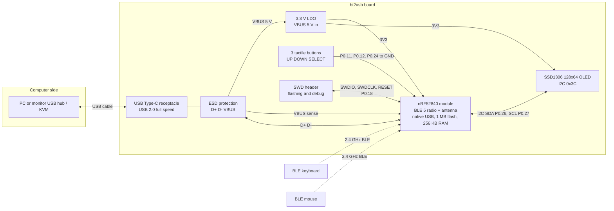
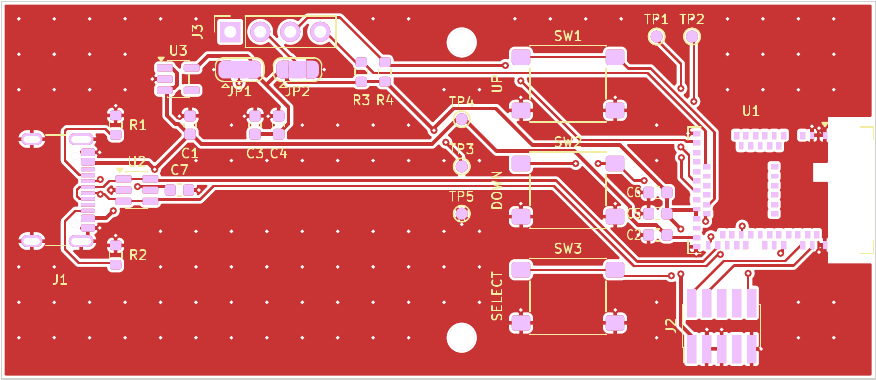

# Hardware And Configuration Reference

The implemented board target is the nRF52840 with native USB, using the DK pin
mapping below. Other boards require a review of their pin routing, clocks, power
supplies, and flash layout. There are no implemented ESP32, RP2040, or STM32 ports.

This guide is the reference for what the firmware expects from the hardware:
parts, wiring, electrical behavior of the buttons and display, power, clocks
and radio settings, compile-time configuration, the memory map, and what to
change for another nRF52840 board, and what a hardware partner needs to
build a [custom board](#custom-board). Bring-up steps are in
[first flash](first-flash.md); the byte formats stored in flash are in the
[data model](data-model.md).

No hardware acceptance record is committed yet (see the validation record in
[testing](testing.md)). Statements below about pins, clocks and memory come
from source and linker scripts; statements about how a particular board,
display, hub or host behaves are acceptance targets until a recorded
first-flash run covers them.

## Parts And Wiring

### Bill Of Materials

| Item | Quantity | Development example | Notes |
| --- | --- | --- | --- |
| MCU board | 1 | nRF52840-DK | BLE radio, native USB, internal flash. The board must route the nRF52840's USB D+, D− and VBUS to a connector and expose SWD |
| Debug probe | 1 | The DK's on-board debugger, reached through its debugger USB port (J2) | Other boards need an SWD probe that `probe-rs` supports (`mask probe-list`) |
| SoftDevice | 1 image | Nordic S140 v7.3.0 (`s140_nrf52_7.3.0_softdevice.hex`) | Flashed once per board with `mask softdevice`; the memory map assumes this version |
| Display | 1 | SSD1306 128×64 I2C module at address `0x3C` | A module strapped to `0x3D` needs a code change; see [OLED Display](#oled-display) |
| Buttons | 3 | DK buttons 1–3, or normally open momentary switches | Active-low to GND; no external resistors needed |
| USB cables | 2 | Data-capable cables | One for the debugger port, one for the nRF USB port (J3) that the PC sees; a charge-only cable fails enumeration |
| Jumper wires | As needed | Female-to-female or to the DK headers | OLED SDA, SCL, VDD, GND; external buttons if used |
| BLE peripherals | Up to 2 active, 4 stored | BLE HID-over-GATT keyboard and mouse | Bluetooth Classic devices are not supported |
| Host side | 1 each | PC; monitor with a USB hub | The hub's upstream cable goes to the PC; hub power behavior affects the bridge (see [Power](#power)) |
| Enclosure | Optional | Board-specific | No enclosure design is maintained in this repository; the requirements for one are under [Enclosure](#enclosure) |

### Wiring

| Signal | Pin | Connection |
| --- | --- | --- |
| UP | P0.11 | Switch to GND, internal pull-up |
| DOWN | P0.12 | Switch to GND, internal pull-up |
| SELECT | P0.24 | Switch to GND, internal pull-up |
| OLED SDA | P0.26 | SSD1306 SDA |
| OLED SCL | P0.27 | SSD1306 SCL |
| OLED power | VDD / GND | The board's I/O supply rail and common ground; not a 5 V rail |
| USB D+/D− | Native USB connector | Routed on the DK; no jumper wiring |

```text
   nRF52840-DK                                0.96" SSD1306 I2C module
 ┌───────────────────────┐                   ┌──────────────────┐
 │ VDD  ─────────────────┼───────────────────┤ VCC              │
 │ GND  ─────────────────┼───────────┬───────┤ GND              │
 │ P0.26 ────────────────┼───────────┼───────┤ SDA              │
 │ P0.27 ────────────────┼───────────┼───────┤ SCL              │
 │                       │           │       └──────────────────┘
 │ P0.11 (Button 1) ─────┼──[UP]─────┤
 │ P0.12 (Button 2) ─────┼──[DOWN]───┤      external buttons optional:
 │ P0.24 (Button 3) ─────┼──[SELECT]─┘      the DK's buttons 1–3 are
 │                       │                  already on these pins
 │ nRF USB (J3) ─────────┼──► PC or monitor hub (data cable)
 │ Debugger USB (J2) ────┼──► PC used for flashing
 └───────────────────────┘
```

The firmware's pin assignments are instantiated in [main.rs](../src/main.rs),
[selftest.rs](../src/selftest.rs), and [sim.rs](../src/sim.rs). The comments in
[config.rs](../src/config.rs) document the defaults; changing comments alone does
not reroute peripherals. The `config.rs` comment also lists P0.06 as a status
LED, which no code drives (see below).

On the DK, P0.11, P0.12 and P0.24 are also wired to on-board buttons 1, 2 and
3, so those work as UP, DOWN and SELECT without extra switches. P0.26 and P0.27
are free GPIOs on the DK. Power the OLED from VDD so any pull-ups on the module
pull SDA and SCL to the nRF52840's I/O voltage; nRF52840 GPIOs are not 5 V
tolerant.

During bring-up, connect native USB directly to the PC. Then move it to the
monitor hub and connect the monitor's USB upstream cable to the PC. A USB
extension or USB-C/USB-A adapter may make the controls easier to reach.

### Pin And Peripheral Usage

| Resource | Bridge (`bt2usb`) | Self-test | Simulation (`bt2usb-sim`) |
| --- | --- | --- | --- |
| P0.11, P0.12, P0.24 | Buttons, GPIO input with pull-up | Same, with an idle-level check | Same, driven by Renode |
| P0.26, P0.27 | TWIM0 SDA, SCL | Same | Not used |
| P0.06, P0.08 | Not used | Not used | UARTE0 TX and RX for the log |
| P0.18 | Pin reset, set in UICR by `embassy_nrf::init` | Same | Same `init` code; Renode's UICR handling not checked |
| P0.09, P0.10 | NFC antenna pins; UICR `NFCPINS` left in NFC mode | Same | Same `init` code; not used |
| USBD | Composite HID device | Same device, one idle mouse report | Not used |
| TWISPI0 (TWIM0) | OLED | OLED probe and Home screen | Not used |
| GPIOTE | Async button edges | Async button waits | Async button edges |
| RTC1 | `embassy-time` driver (`time-driver-rtc1`) | Same | Same |
| Internal flash pages 240–243 | Pairing store | Scratch record, then removed | Not used |

The SoftDevice owns the radio and the POWER and CLOCK peripherals. Because it
owns POWER, the application learns about USB power through SoftDevice events
(comments in [main.rs](../src/main.rs) and
[usb/hid_device.rs](../src/usb/hid_device.rs)).
Flash writes go through the SoftDevice flash API. Check Nordic's S140
specification before claiming any further peripheral, timer or PPI resource.

P0.18, P0.09 and P0.10 are not free GPIOs. The bridge and the self-test pass
`embassy_nrf::init` its default configuration with only the interrupt
priorities changed, and [Cargo.toml](../Cargo.toml) enables neither the
`reset-pin-as-gpio` nor the `nfc-pins-as-gpio` feature of `embassy-nrf`. On
every boot `init` therefore makes sure UICR `PSELRESET` selects P0.18 as the
pin reset and `NFCPINS` keeps P0.09 and P0.10 in NFC mode. On chips with build
code `F` or later it also writes the UICR value that keeps the SWD port open.
Whenever it had to write UICR, it resets the chip once. The simulation build
uses the same default configuration. This is source-derived from `embassy-nrf`
0.7.0, not observed on a board; the UICR behavior and its security effect are
in [security](security.md#physical-access-and-debug-port).

`config.rs` names P0.06 as a status LED, but no firmware code drives it. On the
nRF52840-DK the user LEDs are on P0.13–P0.16 and P0.06 is the UART TX line to
the on-board debugger's virtual serial port; the simulation build uses the same
pin for its UART log.

The SoftDevice reserves interrupt priorities 0, 1 and 4. The bridge and the
self-test set GPIOTE, the time driver, USBD and TWISPI0 to priority 2
([main.rs](../src/main.rs)). Any new peripheral interrupt must use 2, 3, 5, 6
or 7. The simulation build has no SoftDevice and keeps the `embassy-nrf`
defaults.

## Buttons

| Property | Value | Source |
| --- | --- | --- |
| Electrical | Active-low; pressed connects the pin to GND | [ui/buttons.rs](../src/ui/buttons.rs) |
| Pull | nRF52840 internal pull-up (`Pull::Up`); no external resistor | `button_task` |
| Debounce | 50 ms (`BUTTON_DEBOUNCE_MS`) on press and on release | [config.rs](../src/config.rs) |
| Events | One `ButtonEvent` per press; no auto-repeat or long press | `button_task` |
| Queue | `BUTTON_CHANNEL`, capacity 4; the task waits when it is full | [main.rs](../src/main.rs) |

Each button has its own task. It waits for a low level, waits 50 ms, and sends
the event only if the pin is still low. It then waits for a high level that is
still high 50 ms later before it re-arms. Consequences:

- A press shorter than the debounce time can be missed.
- A button held at boot produces one event once the task starts.
- A release that happens while the task waits on a full channel is still seen,
  because the task waits for a level, not an edge.

The UI decides what a press does. While the OLED is off, the first press only
wakes it; while a saved-device request is pending, presses are ignored
([data model](data-model.md#ui-state-model)).

In Renode, button edges are injected on `gpio0` and reach the same driver
through custom GPIO and GPIOTE models of the pin SENSE, LATCH and DETECT
chain that raises the GPIOTE PORT event
([ADR 0014](adr/0014-renode-gpio-models.md), [testing](testing.md#renode-simulation)).
The self-test checks each pin reads high at rest, then waits up to 20 s for a
press.

## OLED Display

| Property | Value | Source |
| --- | --- | --- |
| Controller and size | SSD1306, 128×64, rotation 0 | [ui/display.rs](../src/ui/display.rs) |
| Bus | TWIM0 (`TWISPI0`), SDA P0.26, SCL P0.27; `display::new_twim` sets it up for the bridge, the self-test, and the simulation | [main.rs](../src/main.rs), [ui/display.rs](../src/ui/display.rs) |
| I2C address | `0x3C`, from the `ssd1306` crate's default `I2CDisplayInterface::new`; the self-test probes the same `OLED_ADDR` | [ui/display.rs](../src/ui/display.rs), [selftest.rs](../src/selftest.rs) |
| Bus frequency | 100 kHz, the `embassy-nrf` 0.7 `twim::Config` default, which `new_twim` leaves; a full frame (64 writes of 17 bytes) takes about 0.1 s, and a render that initializes the panel sends two, about 0.22 s | [ui/display.rs](../src/ui/display.rs) |
| Pull-ups | Internal SDA and SCL pull-ups enabled (about 13 kΩ per the source comment); harmless alongside module pull-ups | [ui/display.rs](../src/ui/display.rs) |
| Transmit scratch buffer | 64 bytes in RAM, needed for flash-resident command sequences | [ui/display.rs](../src/ui/display.rs) |
| Rendering | Buffered graphics mode (a 1024-byte framebuffer for 128×64 pixels), `FONT_6X10`; each screen's lines come from `ui::layout` | [ui/display.rs](../src/ui/display.rs), [ui/layout.rs](../src/ui/layout.rs) |
| Initialization | Horizontal addressing and a blank frame while power-up still holds the panel off, then the `ssd1306` crate's `init` (which ends by turning the panel on) and display off until the first frame is sent, so the panel never shows the random RAM content it powers up with | `initialize` in [ui/display.rs](../src/ui/display.rs) |
| Display power | `set_display_on(false)` after inactivity; the module stays powered | [ui/display.rs](../src/ui/display.rs) |
| Operation deadline | 500 ms, then a TWIM STOP request while the DMA future is kept | `finish_or_stop` |
| Retry backoff | 1 s, doubling, capped at 30 s, reset after a success | [ui/display_logic.rs](../src/ui/display_logic.rs) |

The display runs in its own task and only ever renders the latest published
frame, so an I2C fault cannot stall input delivery
([ADR 0009](adr/0009-isolated-display-task.md)). On a NACK or overrun the
`StopSafeI2c` wrapper waits for the TWIM STOPPED event before returning, because
the pinned driver returns before the stop completes. A bus held low
electrically leaves the display task degraded while the bridge continues; the
log then repeats `"OLED I2C error: STOP not complete; requesting again"`, or
shows `"OLED I2C stalled; requesting STOP, display task degraded until DMA completes"`
after the 500 ms deadline. Normal recovery logs `"OLED initialized/recovered"`;
a failed attempt logs
`"OLED operation failed; retry in {} ms (bridge remains active)"`.

For a module at `0x3D`, construct the display interface with the `ssd1306`
crate's alternate-address constructor in `ui/display.rs` and change `OLED_ADDR`
in `selftest.rs`. The self-test's first write is the command stream
`[0x00, 0xAE]` (display off), which a missing panel NACKs.

## USB Connection

| Property | Value | Source |
| --- | --- | --- |
| Connector | The nRF USB port (J3 on the DK), not the debugger port | [first flash](first-flash.md) |
| VBUS detection | Software detector fed by SoftDevice USB power events | [sd_setup.rs](../src/sd_setup.rs), [main.rs](../src/main.rs) |
| Boot state | Read from the SoftDevice's USB regulator status: bit 0 VBUS detected, bit 1 output ready (`"USB power: vbus={} ready={}"`) | `enable_usb_power_events` |
| Fallback | If the events cannot be enabled, VBUS is assumed present (`"failed to enable USB power events; assuming VBUS present"`); if the regulator status cannot be read, VBUS is also assumed present, without a log line | `enable_usb_power_events` |
| Identity and descriptors | VID/PID, strings, serial, interfaces | [data model](data-model.md#usb-device-identity) |

The SoftDevice owns the POWER peripheral, so the application cannot use the
hardware VBUS detector. `softdevice_task` forwards `PowerUsbDetected`,
`PowerUsbRemoved` and `PowerUsbPowerReady` to the USB driver, which is how an
unplug and replug is noticed after boot. The self-test prints
`"USB: no VBUS yet; plug the nRF USB port (not the debugger port) into the PC"`
when it sees no VBUS.

## Power

The bridge is designed to be bus-powered from the PC or the monitor's USB hub
and to stay connected rather than sleep
([ADR 0012](adr/0012-bus-powered-no-system-off.md)).

| Aspect | Implemented behavior | Source |
| --- | --- | --- |
| Supply | USB bus power; there is no battery support or battery measurement | [power.rs](../src/power.rs) |
| Deep sleep | Never enters System-OFF, which would drop USB enumeration and the BLE links | [power.rs](../src/power.rs) |
| CPU idle | The Embassy executor waits for events between tasks | [power.rs](../src/power.rs) |
| BLE timing | 7.5–15 ms connection interval, latency 0, in every power state | [config.rs](../src/config.rs) |
| Power states | `Active`; `Idle` after 60 s without activity; `LowPower` while USB is suspended, or after 120 s without activity and with no BLE link | [power_logic.rs](../src/power_logic.rs), `IDLE_TIMEOUT_SECS` in [power.rs](../src/power.rs) |
| What the states change | Only whether the OLED is on; `LowPower` turns it off | `PowerManager::display_on` |
| OLED auto-off | After 120 s without activity (the sources are listed below) | `SCREEN_AUTO_OFF_TIMEOUT_SECS` |
| Declared USB power | 100 mA in the configuration descriptor | [usb/hid_device.rs](../src/usb/hid_device.rs) |
| Supply regulators | The internal LDOs, no DC/DC converter; UICR `REGOUT0` set to 3.3 V (`reg0_voltage`), which only a board in high-voltage mode uses | `main` in [main.rs](../src/main.rs) and [selftest.rs](../src/selftest.rs) |
| Measured current | Not measured; no figure is recorded in this repository | — |

The 100 mA declaration is a budget the host or hub may enforce, not a measured
value. Measure the board plus OLED with two links active, during scans, and
with the display on before relying on it. The firmware does nothing to reduce
current while the host suspends the bus: BLE links, reconnect attempts and the
radio stay active, and no attempt is made to meet the USB suspend-current
limit. Whether a given host or hub tolerates that is a hardware acceptance
question.

Activity that keeps the display on and the state `Active` comes from button
presses, every `BleEvent::Connected` (including the one sent when one of two
links drops and the other stays up), USB resume, and HID reports passing
through the dispatcher (`note_hid_activity`). USB suspend forces `LowPower`
immediately and resume returns to `Active`.

Hub and DK considerations:

- Some monitors switch their hub off with the panel. The bridge then loses
  power and boots again when power returns, reconnecting up to two stored peers.
  Losing power during a flash write is not yet a tested case; power-loss-safe
  persistence is open in [TODO.md](../TODO.md).
- The DK can be powered from either USB connector. During bring-up both are
  usually connected; in the monitor only the nRF USB cable is. Set the DK's
  power switch and power-source selection, as described in Nordic's DK
  documentation for your board revision, so the board runs from the nRF USB
  connector alone, and confirm it does before moving it to the hub. The
  firmware cannot detect how the board is powered.
- Record the supply arrangement with the hardware acceptance evidence, as
  [testing](testing.md#hardware-acceptance-evidence) requires.

### Supply Mode

The nRF52840 can be supplied two ways, and the firmware supports both:

- **Normal-voltage mode (recommended).** An external 3.3 V regulator feeds
  VDD and VDDH is tied to VDD. This is how the nRF52840-DK is supplied, and
  VDD is 3.3 V from the first instant whatever UICR holds; `REGOUT0` has no
  effect.
- **High-voltage mode.** VBUS (5 V) goes into VDDH and the chip's REG0 makes
  VDD at the voltage UICR `REGOUT0` selects, so no external regulator is
  needed. An erased UICR selects 1.8 V, too low for the OLED module, so the
  bridge and the self-test set `reg0_voltage` to 3.3 V before
  `embassy_nrf::init`, which writes `REGOUT0` on the first boot after a UICR
  erase and resets once ([security](security.md#physical-access-and-debug-port)).
  VDD is 1.8 V only for the few milliseconds before `init` runs on that boot.
  REG0 supplies at most 25 mA to circuits outside the chip (nRF52840 product
  specification), which covers the OLED; check a module's datasheet for its
  own limit. A UICR that already holds a lower voltage, for example from a
  module maker's test firmware, cannot be raised without an erase; `init` then
  logs `Failed to set regulator voltage` and VDD stays low until a full chip
  erase.

Either way the OLED and the I2C pull-ups run from VDD, and nothing on the
board takes VBUS directly except the regulator (if fitted), VDDH (in
high-voltage mode), and the nRF52840 VBUS pin.

## Clocks And Radio

The SoftDevice configuration is shared by the bridge and the self-test in
[sd_setup.rs](../src/sd_setup.rs)
([ADR 0002](adr/0002-nrf52840-softdevice-embassy.md)).

| Setting | Value | Meaning |
| --- | --- | --- |
| Low-frequency clock source | Internal RC oscillator (`NRF_CLOCK_LF_SRC_RC`) | No 32.768 kHz crystal is required or used |
| RC calibration interval | `rc_ctiv = 16` | In SoftDevice units of 0.25 s: every 4 s |
| Temperature-based calibration | `rc_temp_ctiv = 2` | Calibrate when the temperature changed, and at least every second interval |
| Declared LF accuracy | 500 ppm | Used by the SoftDevice for timing windows |
| High-frequency crystal | Requested at boot by `request_hfxo` (`sd_clock_hfclk_request`) and never released | USB clocks from it; without the request the SoftDevice would run it only around radio activity |
| Link count | `conn_count`, `central_role_count`, and `central_sec_count` all equal `BLE_MAX_CONNECTIONS` (2) | Two central links, both able to use security |
| Advertising and peripheral role | `adv_set_count = 0`, `periph_role_count = 0` | The bridge never advertises |
| Connection event length | 6 (`BLE_CONN_EVENT_LENGTH`), 7.5 ms | Short enough for two links to interleave |
| ATT MTU | 64 bytes, requested on each connection by `connect_with_security`; the link uses the smaller of 64 and the peripheral's offer, never below 23 | Bounds GATT fragments; Report Maps are read in pieces of the link's MTU minus 1 |
| GAP device name and other options | Not set | SoftDevice defaults |

The values are from `sd_setup.rs`; the meaning of the clock fields (units of
`rc_ctiv` and `rc_temp_ctiv`) comes from Nordic's S140 API documentation
(`nrf_sdm.h`), which is not in this repository.

The nRF52840-DK fits a 32.768 kHz crystal, but this firmware does not use it.
A board with a crystal may switch to `NRF_CLOCK_LF_SRC_XTAL` with the crystal's
accuracy and both calibration fields set to 0; that change needs its own
hardware test.

The USB peripheral needs the 64 MHz high-frequency crystal oscillator (HFXO)
and does not start it, and `embassy-nrf` leaves the high-frequency clock on its
internal oscillator (`HfclkSource::Internal` in its default `Config`). Once the
SoftDevice is enabled the CLOCK peripheral is the SoftDevice's, and it runs the
crystal only around radio events unless the application asks for it, so the
bridge and the self-test call `request_hfxo` right after `Softdevice::enable`
and before USB starts. It requests the crystal through the SoftDevice and polls
until it runs, logging `HFXO running after N us`, or warns after 50 ms and
boots on without it. The request is never released, so the crystal also runs
while the host suspends the bus; its current is part of the
[power budget](../TODO.md#ui-display-and-power) still to be measured. The radio
needs the same crystal, so every nRF52840 board fits one. The request is
verified only by the embedded build; USB stability with it is a
[first-flash check](first-flash.md#8-extended-acceptance-optional).

Radio parameters that are not in `config.rs` come from the vendored
`nrf-softdevice` defaults ([ScanConfig in central.rs](../vendor/nrf-softdevice/src/ble/central.rs)):

| Parameter | Value |
| --- | --- |
| Scan type | Active for user scans, so scan responses supply names; passive for reconnect scans, which need only the advertiser's address and count only connectable advertisements |
| Extended scanning | Enabled (vendored default) |
| PHY | 1M |
| Scan interval / window | User scans and slow reconnect scans: the vendored default of 2732 / 500 in 0.625 ms units, about 1.7 s / 312.5 ms. Reconnect scans for 30 s after power-up or a lost link, and every connection attempt: 160 / 80, a 50 ms window every 100 ms |
| Scan and initiator TX power | 0 dBm (`TxPower::ZerodBm`); connections inherit it |
| User scan duration | Stops at the first advertisement after 8 s (`BLE_SCAN_DURATION_SECS`), or at a 10 s backstop; there is no boot scan |
| Connection attempt | Whitelist scan for the target at 160 / 80, timeout 6 s (`BLE_CONNECT_TIMEOUT_SECS`) |
| Reconnect scan | Up to 6 s for an address that either slot's stored IRK resolves or that equals its stored address; a device heard for the other slot is handed over |
| Connection parameters | 7.5–15 ms interval, slave latency 0, 4 s supervision timeout; a peripheral's later request is answered within 7.5–15 ms (up to 30 ms for one that asks only for slower intervals), latency at most 20, and a 1–4 s supervision timeout |
| Security | `IoCapabilities::None` (Just Works), bonding allowed; before HID discovery the worker polls up to 25 times, 200 ms apart (about 5 s), for an encrypted security mode (`wait_for_secure_link` in [slot_link.rs](../src/ble/slot_link.rs)) |

One GAP scan or connection setup runs at a time (`GAP_PROCEDURE` in
[ble/mod.rs](../src/ble/mod.rs)), because the SoftDevice rejects a second one.
Pairing is unauthenticated Just Works for now
([ADR 0011](adr/0011-interim-just-works-pairing.md),
[security](security.md#pairing-and-authentication)). No antenna, range or RF
coexistence measurements are recorded.

## Configuration Defaults

These are compile-time settings from [config.rs](../src/config.rs).

| Setting | Default | Meaning |
| --- | --- | --- |
| `BLE_MAX_CONNECTIONS` | 2 | Simultaneous links; sizes the coordinator slots, slot workers and channels, report-merger sources, host-LED receivers, and SoftDevice link counts |
| `BLE_SCAN_DURATION_SECS` | 8 | Scan window in seconds |
| `BLE_MAX_DISCOVERED` | 8 | Maximum cached scan results, the strongest HID advertisers heard; also the Devices screen's list capacity |
| `BLE_CONN_INTERVAL_MIN` / `MAX` | 6 / 12 | 7.5–15 ms, in 1.25 ms units |
| `BLE_SLAVE_LATENCY` | 0 | Connection events a peripheral may skip |
| `BLE_CONN_EVENT_LENGTH` | 6 | 7.5 ms SoftDevice event length, in 1.25 ms units |
| `BLE_SUP_TIMEOUT` | 400 | 4-second supervision timeout, in 10 ms units |
| `BLE_CONNECT_TIMEOUT_SECS` | 6 | Connection-attempt and reconnect scan timeout |
| `BLE_RECONNECT_BACKOFF_MS` | 500 | Pause between reconnect attempts |
| `BLE_FAST_SCAN_INTERVAL` / `WINDOW` | 160 / 80 | A 50 ms window every 100 ms, in 0.625 ms units, for connection attempts and fast reconnect scans |
| `BLE_FAST_RECONNECT_SECS` | 30 | How long reconnect scans stay fast after power-up or a lost link |
| `BLE_RECONNECT_SIGHTING_TTL_MS` | 2000 | How long a sighting one slot's scan hands to the other stays usable |
| `BLE_FAILED_RECONNECT_HOLDOFF_MS` | 6500 | How long the other slot's reconnect scans ignore a device after a failed attempt; derived from `BLE_CONNECT_TIMEOUT_SECS` and `BLE_RECONNECT_BACKOFF_MS` |
| `BLE_PEER_MAX_CONN_INTERVAL` | 24 | Longest interval (30 ms) granted to a peripheral that asks only for intervals slower than 15 ms |
| `BLE_MAX_PERIPHERAL_LATENCY` | 20 | Largest peripheral latency granted to a peripheral's request |
| `BLE_MIN_SUP_TIMEOUT` | 100 | Shortest supervision timeout granted to a peripheral's request (1 s); the longest is `BLE_SUP_TIMEOUT` |
| `MAX_PAIRED_DEVICES` | 4 | Stored peers, and the capacity of the Saved Devices list and the UI's snapshot of it; active slots are separately limited by `BLE_MAX_CONNECTIONS` |
| `FLASH_PAGE_SIZE` | 4096 | nRF52840 flash page (erase unit) in bytes |
| `STORAGE_FLASH_PAGE_START` / `COUNT` | 240 / 4 | Pairing storage reservation |
| `STORAGE_FLASH_START` / `END` | `0x000F0000` / `0x000F4000` | Pairing storage byte range, derived from the pages; the linker checks `FLASH` against it |
| `USB_VID` / `USB_PID` | `0x1209` / `0x0001` | Development IDs; obtain an assigned production identity |
| `USB_MANUFACTURER` / `USB_PRODUCT` | `bt2usb` / `BT-to-USB HID Bridge` | USB string descriptors |
| `USB_HID_POLL_MS` | 1 | USB interrupt endpoint polling interval |
| `BUTTON_DEBOUNCE_MS` | 50 | Button debounce interval |
| `SCREEN_AUTO_OFF_ENABLED` | `true` | Enable OLED inactivity power-off |
| `SCREEN_AUTO_OFF_TIMEOUT_SECS` | 120 | OLED inactivity timeout |
| `UI_MANAGEMENT_TIMEOUT_SECS` | 30 | How long the UI waits for a saved-device list, Forget, or reset reply before showing **No reply** |
| `DIAGNOSTICS_REPORT_INTERVAL_SECS` | 60 | Shortest time between two `diagnostics:` log lines while the event counters keep changing; see [event counters](operations.md#event-counters) |
| `STACK_GUARD_BYTES` | 4096 | Size of the no-access MPU region at the bottom of the stack, placed at the first multiple of its size above the statics; an overflow faults there and is logged as `stack overflow: ...`. A power of two of at least 32; see [ADR 0026](adr/0026-mpu-stack-guard.md) |

The USB serial is generated from the two factory `FICR.DEVICEID` words as a
16-character uppercase hexadecimal value in `usb/hid_device.rs`. It is stable
across firmware updates and USB ports; there is no shared serial constant.

### Constants Outside config.rs

These hardware-relevant values live next to the code that uses them:

| Value | Default | Source |
| --- | --- | --- |
| Idle timeout (`IDLE_TIMEOUT_SECS`) | 60 s | [power.rs](../src/power.rs) |
| Flash write attempts and retry pause | 3, 20 ms apart | [storage.rs](../src/storage.rs) |
| Pairing item size limit (`MAX_RECORD_SIZE`) | 512 bytes | [storage/devices.rs](../src/storage/devices.rs) |
| USB endpoint write deadline and retry backoff | 100 ms; 20 ms doubling to 1000 ms | [hid/delivery.rs](../src/hid/delivery.rs) |
| Endpoint queue (`ENDPOINT_QUEUE_CAPACITY`) | 16 reports per endpoint | [hid/delivery.rs](../src/hid/delivery.rs) |
| OLED address in the self-test (`OLED_ADDR`) | `0x3C` | [selftest.rs](../src/selftest.rs) |
| OLED operation deadline, retry backoff | 500 ms; 1 s doubling to 30 s | [ui/display.rs](../src/ui/display.rs), [ui/display_logic.rs](../src/ui/display_logic.rs) |
| Self-test USB, button and scan limits | 10 s, 20 s, 8 s | [selftest.rs](../src/selftest.rs) |

## Memory Layout

The nRF52840 has 1 MiB internal flash and 256 KiB RAM. The configured reservations
in [memory_sd.x](../memory_sd.x) are:

| Region | Address range, end exclusive | Size |
| --- | --- | --- |
| SoftDevice flash | `0x00000000–0x00027000` | 156 KiB |
| Application flash | `0x00027000–0x000F0000` | 804 KiB |
| Pairing/bond storage | `0x000F0000–0x000F4000` | 16 KiB |
| Unused tail flash | `0x000F4000–0x00100000` | 48 KiB |
| SoftDevice RAM reservation | `0x20000000–0x20006000` | 24 KiB |
| Application RAM | `0x20006000–0x20040000` | 232 KiB |

These are reservations, not measured firmware usage. Measure release size with
`mask size` and stack high-water on the board. Record the RAM requirement printed
when SoftDevice is enabled before changing its reservation. No bootloader or DFU
region is currently allocated.

The linker excludes the pairing pages from application flash; their contents
are defined in the [data model](data-model.md#pairing-store). The storage
constants and the linker map change together, and the link fails when only one
of them changes. SoftDevice uses
`__sdata` as its application RAM boundary, so `.data` must begin at the RAM origin
and the stack must remain at the top; the linker asserts this relationship.

The memory decisions are recorded in
[ADR 0010](adr/0010-static-memory-layout.md). Further details:

- [build.rs](../build.rs) writes `memory_sd.x` (bridge and self-test) or
  `memory_sim.x` (simulation) to `OUT_DIR/memory.x`, preceded by two symbols,
  `__bt2usb_storage_start` and `__bt2usb_storage_end`, which it computes from
  `STORAGE_FLASH_START` and `STORAGE_FLASH_END` by compiling
  [config.rs](../src/config.rs) into the build script. The sources are
  deliberately not named `memory.x`, so a stray root file cannot shadow the
  selected layout, and the build refuses `embedded` and `sim` together.
- `memory_sd.x` asserts `ORIGIN(FLASH) + LENGTH(FLASH) == __bt2usb_storage_start`
  and `__bt2usb_storage_end <= 0x00100000`. Changing the page constants or the
  `FLASH` length alone fails the link with
  `FLASH in memory_sd.x must end at STORAGE_FLASH_START in src/config.rs; change both together`,
  and storage that runs past the end of flash fails with
  `pairing storage (STORAGE_FLASH_PAGE_START/COUNT in src/config.rs) must end within the 1 MB of flash`.
- The RAM assertion in `memory_sd.x` is
  `__sdata == ORIGIN(RAM) && _stack_start == ORIGIN(RAM) + LENGTH(RAM)`.
  `flip-link` would break it, so [.cargo/config.toml](../.cargo/config.toml)
  links with `link.x`, `defmt.x` and `--nmagic`, without `flip-link`.
- At enable time the vendored `nrf-softdevice` logs `"softdevice RAM: {:?} bytes"`.
  If the reservation is too small it panics with
  `"too little RAM for softdevice. Change your app's RAM start address to {:x}"`;
  if it is larger than needed it warns
  `"You're giving more RAM to the softdevice than needed. You can change your app's RAM start address to {:x}"`.
  The `memory_sd.x` comment calls 24 KiB generous for two central links with a
  64-byte MTU; do not shrink it without a measured value.
- There is no heap. Embassy task futures are statically allocated, and every
  task shares the single stack at the top of RAM. The stack is painted with
  `0xCCCCCCCC` at reset (`cortex-m-rt` `paint-stack`), and the bridge logs
  `"stack high-water: {} of {} bytes"` whenever the deepest use grows. The
  self-test fails its stack stage if half or more of the stack was used.
- The bottom of the stack is a no-access MPU region of `STACK_GUARD_BYTES`
  (4 KiB), at the first 4 KiB boundary at or above the end of the statics
  (`_stack_end`), so an overflow faults before it overwrites `.bss`. In the
  current release bridge the statics end at `0x2000CDA4`, the guard is
  `0x2000D000–0x2000E000`, and the stack above it is 200 KiB; the 604 bytes
  between are never used. The high-water line counts only the stack above the
  guard ([ADR 0026](adr/0026-mpu-stack-guard.md)).
- `.uninit` (1,048 bytes in the release bridge), the last section before
  `_stack_end`, is neither zeroed nor painted at reset. It holds defmt-rtt's
  1 KiB log buffer and the 24-byte record of the last stack overflow, which
  the next boot logs as `previous boot: stack overflow: ...` when the reset
  kept RAM.

The simulation build has no SoftDevice and owns the whole device:

| Region | Address range, end exclusive | Size |
| --- | --- | --- |
| Flash ([memory_sim.x](../memory_sim.x)) | `0x00000000–0x00100000` | 1024 KiB |
| RAM | `0x20000000–0x20040000` | 256 KiB |

## Custom Board

This section is the bt2usb board that runs the firmware unchanged: its
requirements, the rev A KiCad design and production files, debug access,
enclosure, delivery checks, the questions still open, and where to have it
made. It builds on the sections above, which say how the firmware uses each
part; it does not repeat them. Rev A is designed and has passed a design
review ([KiCad Project](#kicad-project-rev-a)) but is not yet built or
looked over by a second person, and the [first-flash checklist](first-flash.md)
is its acceptance test
([TODO.md](../TODO.md#board-bring-up-and-hardware-acceptance),
[ADR 0029](adr/0029-rev-a-board-on-a-certified-module.md)).

The product is a small bus-powered box on a monitor's USB hub or a KVM. It
connects up to two Bluetooth LE keyboards and mice and presents them to the
computer as a wired USB keyboard, mouse and media-control device, so they work
in the BIOS and follow the hub or KVM to the selected computer, with no
Bluetooth or software on the computer ([features](features.md)).

| Responsibility | Hardware partner | Firmware owner |
| --- | --- | --- |
| Schematic and PCB layout | Reviews rev A for manufacturability | Owns the [KiCad project](#kicad-project-rev-a) |
| Fabrication, assembly, part sourcing | Yes, from the [production files](#kicad-project-rev-a) | Reviews substitutions |
| Enclosure design and parts | Yes | Reviews fit and button feel |
| Electrical check of each unit | Yes, see [Acceptance On Delivery](#acceptance-on-delivery) | — |
| SoftDevice S140 and firmware programming | No; ship blank | Yes, over SWD |
| Functional test | No | `mask selftest`, then [first flash](first-flash.md) |

### Block Diagram



### Board Requirements

| Area | Requirement | Details |
| --- | --- | --- |
| MCU | nRF52840, package QIAA (aQFN73), on a pre-certified module | [Module Choice](#module-choice), [Memory Layout](#memory-layout) |
| Chip revision | Revision 3 (build code F or later) preferred | [ADR 0021](adr/0021-provisioning-debug-access-and-readout-protection.md), still Proposed |
| Radio | Antenna integrated in the module; 0 dBm, no amplifier | [Antenna And RF](#antenna-and-rf), [Clocks And Radio](#clocks-and-radio) |
| Crystals | 32 MHz HFXO, ±40 ppm or better (inside the module); no 32.768 kHz crystal needed | [Clocks And Radio](#clocks-and-radio) |
| Supply | USB VBUS only; 3.3 V regulator into VDD with VDDH tied to VDD, or 5 V into VDDH | [Supply Mode](#supply-mode) |
| USB | Native nRF52840 USB 2.0 full speed; VBUS to the nRF52840 VBUS pin | [USB Connection](#usb-connection), [Board Power And USB](#board-power-and-usb) |
| Display | SSD1306 128×64 I2C module at `0x3C`, powered from VDD | [OLED Display](#oled-display) |
| Buttons | Three normally open switches, each from its GPIO to GND, no other parts | [Buttons](#buttons) |
| Debug | SWD reachable without desoldering; no bootloader | [Debug And Flash Access](#debug-and-flash-access) |
| Enclosure | Plastic, OLED window, three actuators, USB-C opening | [Enclosure](#enclosure) |

### Module Choice

A pre-certified module keeps its radio approvals and avoids an RF matching
design. Every nRF52840 has 1 MB of flash and 256 KB of RAM, so the choice is
about the module's antenna and pin breakout:

| Module | Antenna | Notes |
| --- | --- | --- |
| Raytac MDBT50Q-1MV2 | Chip antenna | Rev A's module; breaks out USB D+, D−, VBUS and most GPIOs. Raytac's product page and specification describe it with a revision 2 nRF52840 |
| Raytac MDBT50Q-P1MV2 | PCB antenna | Same family |
| Ebyte E73-2G4M08S1C | PCB antenna | Check that USB and VBUS are broken out |
| Minew MS88SF2 | Chip antenna | Check the GPIO breakout |

The module's datasheet must show the USB D+, D− and VBUS pins, VDD and VDDH
(or its supply mode), SWDIO, SWDCLK and P0.18, and the GPIOs in the
[wiring table](#wiring). If a GPIO is not broken out, propose another free one
and change it as the [porting checklist](#porting-to-another-nrf52840-board)
describes. A preloaded bootloader or test firmware does not matter, because
the firmware owner erases the whole chip over SWD. A chip-down design needs
Nordic's reference circuit (crystal, DEC1 to DEC6 decoupling, RF matching,
antenna), an RF layout review and its own certification, and is not
recommended for a prototype.

### Board Pin Map

The button and display pins are in the [wiring table](#wiring). The board adds:

| Signal | nRF52840 pin | Connect to | Notes |
| --- | --- | --- | --- |
| USB_DP | D+ | Connector D+ (A6 and B6 on Type-C) | Routed beside D−, short, no series resistors |
| USB_DM | D− | Connector D− (A7 and B7 on Type-C) | As above |
| VBUS | VBUS | Connector VBUS after ESD | Required for USB to start |
| SWDIO, SWDCLK | SWDIO, SWDCLK | SWD connector | — |
| nRESET | P0.18 | SWD connector, optional reset switch to GND | Kept as the pin reset ([pin usage](#pin-and-peripheral-usage)) |
| TP1, TP2 | P0.06, P0.08 | Test pads | Unused by the bridge; useful for a debug UART |
| TP3, TP4, TP5 | — | Test pads | 3V3, VBUS and GND, for the [delivery checks](#acceptance-on-delivery) |
| OLED_P1, OLED_P2 | — | J3 pins 1 and 2, through JP1 and JP2 | GND and 3V3 as delivered; swapped by cutting the jumpers' bridges and closing pads 2–3 |

Leave P0.00 and P0.01 (32.768 kHz crystal), P0.09 and P0.10 (NFC) and P0.18
free of anything that drives them. No LED is driven by the firmware; a power
LED on VDD is optional at 1 mA or less.

### KiCad Project (Rev A)

The board is a KiCad 9 project in `hardware/bt2usb-board`; KiCad 9.0.9
wrote the board and checked both files. The schematic file is in the
KiCad 7 format, which KiCad 9 reads and upgrades on save.

| File | Contents |
| --- | --- |
| `hardware/bt2usb-board/bt2usb-board.kicad_pro` | Project, with the design rules below |
| `hardware/bt2usb-board/bt2usb-board.kicad_dru` | One custom rule: the USB-C shield tabs may meet the ground pour with one thermal spoke per layer |
| `hardware/bt2usb-board/bt2usb-board.kicad_sch` | Schematic, one A4 sheet, with design notes |
| `hardware/bt2usb-board/bt2usb-board.kicad_pcb` | Placed and routed two-layer board |
| `hardware/bt2usb-board/bt2usb-board-schematic.pdf` | Schematic as PDF, for reading without KiCad |
| `hardware/bt2usb-board/fab/bt2usb-board-gerbers.zip` | Gerbers (copper, mask, paste, silkscreen, outline), Excellon drill file and drill map |
| `hardware/bt2usb-board/fab/bt2usb-board-bom.csv` | Bill of materials with manufacturer part numbers |
| `hardware/bt2usb-board/fab/bt2usb-board-placement.csv` | Pick-and-place file, origin at the bottom-left board corner |
| `hardware/bt2usb-board/images/top.png`, `bottom.png` | Copper and silkscreen of each side |



| Property | Rev A |
| --- | --- |
| Size | 74 × 32 mm, two layers, 1.6 mm FR-4 recommended |
| Rules | Track 0.2 mm signals and 0.3 mm power, 0.15 mm minimum; clearance 0.15 mm; vias 0.6 mm on 0.3 mm drill; copper to edge 0.3 mm; copper to hole 0.18 mm, which the USB connector's own footprint needs |
| Layout | USB-C on the left edge, the OLED socket along the top with the display module over the supply parts, buttons in a column right of the display, the module on the right with its antenna at the board edge and a keep-out on both layers to the edge, SWD header below the module, two M2 holes |
| Ground | A ground pour on both layers, tied by a via at every SMD ground pad and by stitching vias on a 3 mm grid; the bottom is an almost unbroken plane under the USB pair |
| USB pair | D+ and D− run side by side on the top layer: 55.6 and 58.9 mm long, 81 % of D− within 0.6 mm of D+, four vias on D− where the Type-C pin rows cross |
| Supply | Normal-voltage mode ([Supply Mode](#supply-mode)): U3 makes 3.3 V, VDDH tied to VDD; C2 decouples the module's VBUS pin and C7 the ESD array's |
| OLED | J3 is a 1×4 2.54 mm socket the module plugs into. JP1 and JP2 set its supply order: as delivered (pads 1–2 bridged) J3 is GND, VCC, SCL, SDA from pin 1; for a VCC, GND, SCL, SDA module cut both bridges and solder pads 2–3 |

The design was reviewed on 2026-11-10
([record](validation-records.md#validation-record--2026-11-10-rev-a-design-review)):

| Check | Result |
| --- | --- |
| KiCad 9.0.9 ERC, all severities | 0 errors, 0 warnings |
| KiCad 9.0.9 DRC, all severities, with schematic parity | 0 violations, 0 unconnected pads, 0 footprint or parity issues |
| Netlist against the [pin map](#board-pin-map) and `src/main.rs` | Every module pin matches, pin for pin |
| Module pins against Raytac's pin table | All 20 connected pins and the unused ones match the numbers and names in Raytac's MDBT50Q specification (2018 and 2023 editions) |
| Module footprint against Raytac's drawing | Body 15.5 × 10.5 mm and pad numbering match; pad sizes could not be compared, because the drawing is only an image in the specification |
| LDO, ESD array, switch, SWD header, Type-C pins | Match the AP2112K, USBLC6-2SC6, PTS645, ARM 10-pin and Type-C pinouts |
| Module reference circuits | Matches Raytac's "DC/DC and LDO mode disabled" circuit for supplies under 3.6 V: VDD and VDDH tied, DCCH open, no 32.768 kHz crystal (the firmware uses the RC oscillator), no NFC parts |
| OLED clearance and enclosure | See [Enclosure](#enclosure) |

The review changed the design: C2 moved next to the module's VBUS pin, C7
was added at the ESD array, J3 became a socket with JP1 and JP2, the USB pair
was rerouted side by side, and ground stitching was added. Still open
before ordering:

- [ ] Compare the module's pad sizes with Raytac's land-pattern drawing
      (section 2.2 of its specification), which no source here could serve
      as anything but an image.
- [ ] Have someone with board experience look over the schematic and layout.
      The checks above are automatic or done by the designer; nobody else has
      reviewed it.
- [ ] Choose the module's chip revision for anything beyond prototypes
      ([Open Questions](#open-questions), question 5).

To order, upload the Gerber zip to the fab, and for assembled boards add the
BOM and placement file. The OLED module, the cable and the probe are bought
separately (see [Bill Of Materials](#custom-board-bill-of-materials)).

The buttons need no resistors or capacitors. Use switches rated for at least
50,000 cycles, because SELECT is pressed often. The firmware uses the LDO
regulators, not the DC/DC converters.

### Board Power And USB

The firmware's power behavior and the 100 mA declaration are under
[Power](#power); current draw is unmeasured but expected well below 100 mA.

| Item | Requirement |
| --- | --- |
| Input | USB VBUS, 4.4–5.25 V |
| Regulator (normal-voltage mode) | 3.3 V, at least 300 mA, input rating at least 6 V |
| VBUS capacitance | 10 µF or less in total (USB inrush limit); rev A has 5.8 µF: C1 4.7 µF at the regulator, C2 1 µF at the module's VBUS pin, C7 100 nF at the ESD array |
| Connector | USB Type-C receptacle, USB 2.0 only, 5.1 kΩ pull-downs on CC1 and CC2 so C-to-C cables supply power |
| Cable | One data-capable USB-C to USB-A cable per unit; a charge-only cable fails enumeration |
| ESD | Low-capacitance TVS array on D+, D− and VBUS next to the connector |
| Routing | D+/D− side by side, lengths within a few millimetres, no stubs, continuous ground under them. The nRF52840 is full speed only (12 Mbit/s); its edges are slower than the delay of a few centimetres of track, so a two-layer board needs no impedance control |

### Antenna And RF

- Follow the module maker's reference layout: antenna end at the board edge,
  the copper keep-out on every layer as drawn, and ground stitching vias
  along the module's ground pads.
- Keep the USB connector, the OLED and any metal out of the keep-out.
- The bridge often sits on a monitor's metal back: put the antenna at the end
  of the case away from the mounting face, and use a plastic case with no
  metal paint or metallized label over it.
- No NFC antenna is fitted. No range or coexistence measurement exists yet.

### Debug And Flash Access

All programming and recovery uses SWD. Rev A has J2, a 2×5 1.27 mm ARM Cortex
debug header that a J-Link or CMSIS-DAP 10-pin cable plugs into: pin 1 VTref
(3.3 V), 2 SWDIO, 4 SWCLK, 10 nRESET (P0.18), 3, 5 and 9 GND, 6 and 8 not
connected, 7 key. The enclosure must leave it reachable through a cover, slot
or screws, and the board is powered from USB while it is programmed. The partner must not program
anything, enable readout protection or write UICR; the firmware owner erases
the chip, installs the SoftDevice and flashes
([first flash](first-flash.md#1-softdevice-once-per-board)). One SWD probe
that `probe-rs` supports, such as a SEGGER J-Link EDU Mini or a CMSIS-DAP
probe, is needed per order.

### Custom Board Bill Of Materials

The parts placed on the board, with manufacturer part numbers, are in
`hardware/bt2usb-board/fab/bt2usb-board-bom.csv`. The passives are generic
0603 parts; ceramic capacitors are X5R or X7R rated 10 V or more. Also needed
per unit, and not in that file:

| Item | Requirement |
| --- | --- |
| OLED module | 0.96" 128×64 SSD1306 I2C, 4-pin, address `0x3C`, runs from 3.3 V, with its 2.54 mm pin header fitted; it plugs into J3. Either supply order works once JP1 and JP2 are set |
| PCB | Rev A Gerbers, 1.6 mm FR-4, two layers |
| Enclosure set | See [Enclosure](#enclosure) |
| Cable | USB-C to USB-A, 1 m, data-capable |

### Enclosure

| Item | Requirement |
| --- | --- |
| Material | ABS, PC or PC/ABS; no metal over the antenna |
| Size | As small as the board allows; partner proposes dimensions |
| Display | Window over the OLED's active area, readable from the front |
| Buttons | Three actuators in a row by the display, marked UP, DOWN, SELECT (or ▲, ▼, ●) |
| USB | Opening that fits common cable overmolds, at least 12.5 × 7 mm |
| Debug access | SWD reachable through a cover, slot or screws, not glue or breaking snap-fits |
| Mounting | Flat back for an adhesive pad; antenna end away from the mounting face |
| Labels | Board revision on the silkscreen; button names on the case |
| Environment | Indoor office use; no ingress rating |

Rev A's heights, checked on 2026-11-10 against the parts in the BOM; the
OLED module's own sizes vary between makers, so measure the one bought:

| Part | Top above the board | Notes |
| --- | --- | --- |
| Passives, U2, U3 | 1.45 mm at most (SOT-23 package limit) | All under the display |
| Module U1 | 2.2 mm at most (Raytac's specification) | Antenna end at the right edge |
| Tactile switches | 4.3 mm (PTS645 "43" height code) | The case needs plungers from its top surface down to them |
| OLED module board | About 11 mm: the 8.5 mm socket plus the 2.5 mm spacer of the module's own header | Clears every part under it by about 9 mm |
| OLED display face | About 13 to 14 mm | Its window sets the case height |

Soldering the module's header straight into J3, without the socket, leaves
2.5 mm under the module's board: the SOT-23 parts take up to 1.45 mm and the
module's own regulator and capacitors face down, so they can touch. Use the
socket. The display then sits about 9 mm above the switch tops, so the case
needs button plungers of about that length, or taller 6 × 6 mm switches
on the same footprint. The module covers roughly x 10–37 mm and
y 1–29 mm from the board's top-left corner (a 27 × 28 mm module centred on
J3); the M2 holes at x 39 mm stay just outside it. Allow about 2 mm under the
board for the socket's and the USB connector's through-hole leads; the
inside of the case then needs about 76 × 34 mm and 18 mm of height.

### Acceptance On Delivery

The partner checks every unit: VDD within 3.2–3.4 V on USB power; an SWD
probe connects (for example `probe-rs info`); JP1 and JP2 match the OLED
module's pin order; SDA, SCL, VCC and GND of the OLED reach P0.26, P0.27,
VDD and GND; each button shorts its GPIO to GND only
while pressed; and the antenna keep-out and USB solder joints pass visual
inspection. The firmware owner then runs `mask selftest` and the
[first-flash checklist](first-flash.md) and files a
[hardware-result issue](../.github/ISSUE_TEMPLATE/hardware-result.md).

Deliverables expected from the partner: manufacturability findings on rev A
before building; the module revision used; the enclosure STEP model; the
assembled units, cables and probe; and two or three spare bare PCBs.

### Open Questions

| # | Question | Recommendation |
| ---: | --- | --- |
| 1 | How many units? | 5 assembled prototypes plus 3 bare PCBs |
| 2 | Custom PCB, or a ready-made nRF52840 board wired as in [Wiring](#wiring)? | A ready-made board first; a custom PCB on a module after the first-flash run |
| 3 | USB Type-C receptacle, captive cable, or USB-A plug? | Type-C with a C-to-A cable, as in rev A |
| 4 | OLED module on a header, or a bare SSD1306 panel on an FPC? | Module for the prototype; a bare panel needs its charge-pump capacitors |
| 5 | Require nRF52840 revision 3? | Not for rev A prototypes: the firmware runs on revision 2, which Raytac documents for the MDBT50Q-1MV2. Yes for production units, so the [ADR 0021](adr/0021-provisioning-debug-access-and-readout-protection.md) lock policy stays available: ask Raytac or the distributor for a revision 3 lot, or choose a module that states it |
| 6 | Normal-voltage or high-voltage mode? | Normal-voltage for the prototype; both work ([Supply Mode](#supply-mode)) |
| 7 | Keep rev A's Raytac MDBT50Q-1MV2? | Yes; another module needs a new footprint and a pin check against [Module Choice](#module-choice) |
| 8 | Enclosure colour, finish, labels and mounting | Partner proposal; adhesive pad mounting |

Known gaps that do not block a prototype: current, range and coexistence are
unmeasured; the production USB identity is not chosen
([ADR 0018](adr/0018-production-usb-identity.md)); product-level EMC and USB
compliance testing is not planned.

### Where To Build It

Checked on 2026-11-09 from each service's own pages; prices, minimums and
programs change, so confirm in the quote tool before ordering.

**A first test unit needs no factory.** An nRF52840-DK, an SSD1306 module, and
jumper wires wired as in [Wiring](#wiring) run the firmware unchanged and are
what the [first-flash checklist](first-flash.md) is written for. They are sold
by the usual distributors (Mouser, DigiKey, Farnell) with delivery within
Europe. Order a custom board only after that run passes.

**A custom board is built from production files,** not from this section:
the schematic, the PCB layout as Gerbers and drill files, a bill of materials
with manufacturer part numbers, and a pick-and-place file. The fabs below
build to those files and offer no design work. Rev A's are in
`hardware/bt2usb-board/fab` ([KiCad Project](#kicad-project-rev-a)).

| Service | Where | Assembled boards | Parts sourcing | Turnaround | Notes |
| --- | --- | --- | --- | --- | --- |
| [AISLER](https://aisler.net/products) | Europe (AISLER B.V.; ships from Germany) | From one board | Through its Simple Supply service, from the major distributors | About 6 business days for assembly; bare boards in 1 business day, in sets of three | First choice for a single assembled prototype made in Europe |
| [Eurocircuits PCB Proto](https://www.eurocircuits.com/pcb-assembly-proto/) | Belgium, European factories | 1 to 5 boards, no minimum order charge | All components sourced by Eurocircuits; customer may supply the rest | About 6 working days (3 build, 3 assembly) | Publishes a non-disclosure agreement |
| [JLCPCB](https://jlcpcb.com/solutions/pcb-prototype-assembly) | China | Minimum 2 boards | Large in-stock part library, global sourcing, or consigned parts | Assembly in 1 to 3 days, plus shipping | Lowest price; parts outside its stock take 9 to 15 days |
| [PCBWay](https://www.pcbway.com/pcb-assembly.html) | China | The quote form starts at 5 boards | Sources from DigiKey, Mouser, Arrow and Avnet | 3 to 5 days for assembly, plus shipping | Signs an NDA on request. Its [sponsorship](https://www.pcbway.com/project/sponsor/learnsponsor.aspx) gives a coupon for bare PCBs to approved non-profit projects; assembly and delivery are not covered |
| [Seeed Fusion](https://www.seeedstudio.com/fusion_pcb.html) | China | "From one to thousands" | Its Open Parts Library and purchasing | About 7 days for assembly | Free DFM/DFA review and free functional testing |

## Porting To Another nRF52840 Board

Work through this list for any board other than the nRF52840-DK, then run the
full [first-flash checklist](first-flash.md). Nothing below has been done for
another board yet.

- [ ] **USB.** Confirm the board routes the nRF52840's USB D+, D− and VBUS to a
      connector the PC or hub can reach. The firmware learns about the cable
      only through VBUS events.
- [ ] **Pins.** Choose GPIOs for the three buttons and the I2C bus that the
      board does not dedicate to something else, for example the 32.768 kHz
      crystal pins (P0.00, P0.01), the NFC antenna pins (P0.09, P0.10), the pin
      reset (P0.18), on-board flash or LEDs. P0.09/P0.10 and P0.18 stay
      reserved unless `embassy-nrf`'s `nfc-pins-as-gpio` or `reset-pin-as-gpio`
      feature is enabled; freeing P0.18 on a chip whose UICR already selects it
      as reset also needs a UICR erase
      ([UICR behavior](security.md#physical-access-and-debug-port)). Change
      them in `main.rs` and `selftest.rs` (including the pin names in the
      self-test messages), update the comments in `config.rs`, and update
      `sim.rs`, the Renode scripts and this guide if the simulation should
      follow.
- [ ] **Buttons.** Keep them active-low with the internal pull-up, or change
      `ui/buttons.rs` and the self-test's idle check together.
- [ ] **Display.** Confirm the module's I2C address and supply voltage; see
      [OLED Display](#oled-display).
- [ ] **Interrupt priorities.** Keep every application interrupt at 2, 3, 5,
      6 or 7, and set any new peripheral's priority explicitly as `main.rs`
      does for USBD and TWISPI0.
- [ ] **Clocks.** The internal RC low-frequency source works without a
      crystal. Switch to a crystal only with a matching accuracy setting and a
      hardware test. USB and the radio both need the 32 MHz crystal of the
      high-frequency oscillator; the boot line `HFXO running after N us`
      shows it started.
- [ ] **SoftDevice and flash map.** Use S140 v7.3.0, or update `memory_sd.x`
      to the other version's flash and RAM requirements. Check that nothing on
      the board, such as a factory bootloader or settings page, uses
      `0x000F0000–0x000F4000` or the rest of the application range. Change
      `STORAGE_FLASH_PAGE_START`/`COUNT` and `memory_sd.x` together; the link
      fails if they disagree.
- [ ] **Chip variant.** The build and `probe-rs` target `nRF52840_xxAA` with
      1 MiB flash and 256 KiB RAM. A different memory size needs new linker
      values.
- [ ] **USB identity.** Replace the development VID/PID before anything
      leaves the lab ([data model](data-model.md#usb-device-identity)).
- [ ] **Supply mode.** Feed VDD from a 3.3 V regulator with VDDH tied to VDD,
      or 5 V into VDDH; in the second case confirm VDD reads 3.3 V after the
      first boot and that the log has no `Failed to set regulator voltage`
      line; see [Power](#power).
- [ ] **Power.** Measure current with the new board and display, and decide
      whether the 100 mA declaration holds; see [Power](#power).
- [ ] **Re-verify.** Run `mask selftest`, record the SoftDevice RAM line and
      the stack high-water, run `mask size`, and complete the first-flash
      checklist with the board revision recorded.

A plug-in nRF52840 USB dongle keeps the same MCU and SoftDevice but has no
OLED, fewer buttons, and a preinstalled USB bootloader. On Nordic's nRF52840
Dongle that bootloader starts at `0xE0000`, inside today's application range
and below the pairing pages, so such a board needs its own pin map, a
display-less UI, and a different flash layout. It is tracked as the
[display-less dongle item](../TODO.md#more-peripherals-and-form-factors).

## Possible Future Ports

ESP32-S3, RP2040 with an external BLE module, and STM32 with an external BLE module
were previously listed as alternatives. They remain design ideas requiring
separate HAL, BLE, USB, pin, memory, and validation work. Only the nRF52840 build
is maintained here.

The parts of the code that are specific to the nRF52840 and would need
replacing in such a port:

| Area | nRF-specific dependency |
| --- | --- |
| BLE central, bonding, flash access | Nordic SoftDevice S140 through `nrf-softdevice` (vendored patch, [ADR 0007](adr/0007-vendored-softdevice-patch.md)) |
| USB device | `embassy-nrf` USBD driver with SoftDevice-fed VBUS detection |
| Unit serial | `FICR.DEVICEID` registers |
| Display bus | TWIM0 and the `StopSafeI2c` STOP handling written for it |
| Memory map | `memory_sd.x` and the SoftDevice RAM boundary assertion |
| Simulation | Renode's nRF52840 platform and the custom GPIO models |

The hardware-free modules (HID parsing and aggregation, coordinator reducers,
UI logic, storage framing) are shared through `src/lib.rs` and would carry
over ([ADR 0003](adr/0003-pure-core-and-task-shell.md)). A port is tracked as
the additional MCU item in [TODO.md](../TODO.md).

## Related Guides

- [First flash](first-flash.md)
- [Architecture and ADRs](architecture.md)
- [Data model](data-model.md)
- [Development](development.md)
- [Testing](testing.md)
- [Operations](operations.md)
